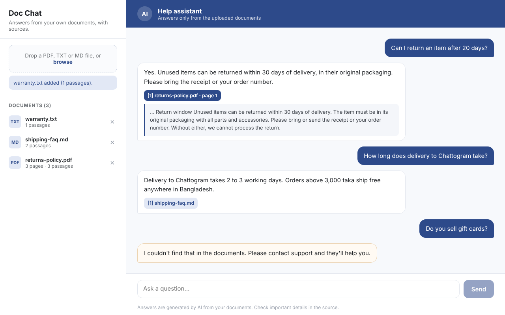

# Doc Chat

An AI help assistant that answers questions from your own documents and shows where each answer came from.

Upload PDFs, text or Markdown files. Ask a question. The assistant finds the most relevant passages and Claude writes a short answer from those passages only, with a source chip for each one (file name and page). If the answer isn't in the documents, it says so instead of guessing.



## Features

- **Answers from your documents only.** Claude is given the matching passages and told to use nothing else.
- **Sources on every answer.** Each answer links to the file and page it used. Click a source to see the exact passage.
- **Honest when unsure.** Questions the documents can't answer get a clear "couldn't find that" reply. When search finds nothing relevant, Claude isn't called at all, so it costs nothing.
- **PDF, TXT and Markdown uploads.** PDFs are read page by page, so page numbers in sources are accurate.
- **Cost control.** A daily question limit per visitor and a cap on answer length. Your API key stays on the server.
- **Tested.** Unit tests cover chunking, search, PDF extraction, citations and the not-found path.

## How it works

```
upload ─► extract text (per page) ─► split into passages ─► store
question ─► BM25 keyword search ─► top passages ─► Claude ─► answer + cited sources
```

1. **Extract.** `lib/extract.ts` reads PDFs page by page with [unpdf](https://github.com/unjs/unpdf), and plain text or Markdown as one block.
2. **Chunk.** `lib/chunk.ts` splits each page into passages of about 900 characters on paragraph and sentence boundaries. A passage never spans two pages.
3. **Search.** `lib/search.ts` ranks passages with BM25, the keyword-ranking formula search engines use. It runs locally, needs no extra API, and costs nothing.
4. **Answer.** `lib/answer.ts` sends the top passages, numbered, to Claude with instructions to cite them like `[1]` and to reply `NOT_FOUND` when the answer isn't there. The server turns citations into source chips.

## Getting started

Requirements: Node.js 20 or later, and an Anthropic API key from [console.anthropic.com](https://console.anthropic.com).

```bash
npm install
cp .env.example .env.local   # then add your ANTHROPIC_API_KEY
npm run dev
```

Open http://localhost:3000 and upload the three files in `samples/` (a fictional store's returns policy, shipping FAQ and warranty terms). Then try:

- "Can I return an item after 20 days?"
- "How long does delivery to Chattogram take?"
- "Do you sell gift cards?" (not in the documents, so it says so)

## Configuration

All settings live in `.env.local`:

| Variable | Default | What it does |
| --- | --- | --- |
| `ANTHROPIC_API_KEY` | none | Your Anthropic API key. Required. |
| `ANTHROPIC_MODEL` | `claude-sonnet-5-5` | The Claude model used for answers. |
| `MAX_ANSWER_TOKENS` | `600` | Upper limit on answer length. |
| `TOP_K` | `5` | How many passages are sent to Claude per question. |
| `DAILY_QUESTION_LIMIT` | `30` | Questions each visitor can ask per day. |
| `NOT_FOUND_REPLY` | "I couldn't find that in the documents…" | The reply when the answer isn't in the documents. |
| `DATA_DIR` | `./data` | Where uploaded documents are stored. |

## Scripts

| Command | What it does |
| --- | --- |
| `npm run dev` | Start the development server |
| `npm run build` then `npm start` | Production build and server |
| `npm test` | Run the unit tests |
| `npm run typecheck` | Check types |

## Project structure

```
app/
  page.tsx              chat and document UI
  api/documents/        upload, list and delete documents
  api/chat/             answer a question
lib/
  extract.ts            PDF / TXT / Markdown to text
  chunk.ts              split pages into passages
  search.ts             BM25 search
  answer.ts             prompt, Claude call, citations, sources
  store.ts              file-backed document store
  ratelimit.ts          daily question limit
samples/                demo documents
tests/                  unit tests
```

## Limits and next steps

- **Scanned PDFs** have no text layer. They need OCR before upload.
- **Keyword search** works well for policies, FAQs and manuals, where questions share words with the answer. For very large or loosely worded collections, add vector embeddings (for example Voyage AI) alongside BM25.
- **Storage** is a JSON file, which suits a demo or a single server. Use a database such as PostgreSQL for multi-user production use.
- **No login.** Add authentication before exposing the upload endpoint publicly.

## License

MIT
